# BUET CSE Courseworks

This repository contains links to my coursework, academic projects, and course-related extra work throughout my undergraduate journey at the **Department of Computer Science and Engineering, BUET**.

> **Note:** Before exploring any linked repository, please read its README first.

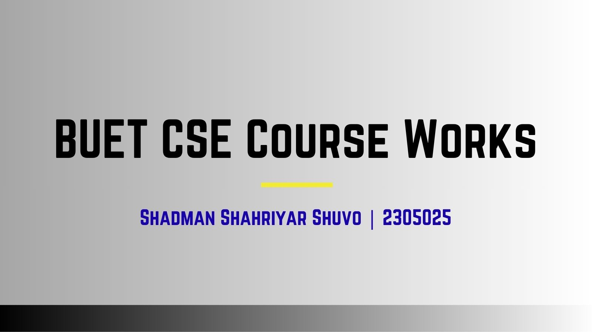

## Table of Contents

- [Level 1 Term 1](#level-1-term-1)
- [Level 1 Term 2](#level-1-term-2)
- [Level 2 Term 1](#level-2-term-1)
- [Level 2 Term 2](#level-2-term-2)
- [Level 3 Term 1](#level-3-term-1)
- [Level 3 Term 2](#level-3-term-2)
- [Level 4 Term 1](#level-4-term-1)
- [Level 4 Term 2](#level-4-term-2)

---

<h2 align="center" id="level-1---term-1">Level 1 - Term 1</h2>

### CSE 102 | Structured Programming Language

[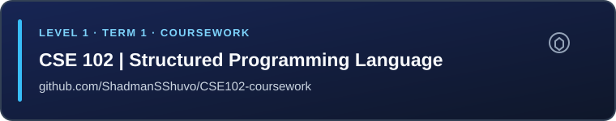](https://github.com/ShadmanSShuvo/CSE102-coursework)

**Repository:** [ShadmanSShuvo/CSE102-coursework](https://github.com/ShadmanSShuvo/CSE102-coursework)

### CSE 102 | iGraphics Project · FlappyBird

[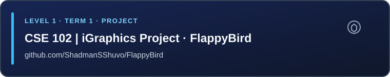](https://github.com/ShadmanSShuvo/FlappyBird)

**Repository:** [ShadmanSShuvo/FlappyBird](https://github.com/ShadmanSShuvo/FlappyBird)

---

<h2 align="center" id="level-1---term-2">Level 1 - Term 2</h2>

### CSE 106 | Data Structures and Algorithms I

[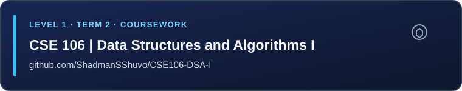](https://github.com/ShadmanSShuvo/CSE106-DSA-I)

**Repository:** [ShadmanSShuvo/CSE106-DSA-I](https://github.com/ShadmanSShuvo/CSE106-DSA-I)

### CSE 108 | Object Oriented Programming

[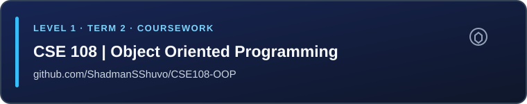](https://github.com/ShadmanSShuvo/CSE108-OOP)

**Repository:** [ShadmanSShuvo/CSE108-OOP](https://github.com/ShadmanSShuvo/CSE108-OOP)

### CSE 108 | JavaFX Project · AlgoMania

[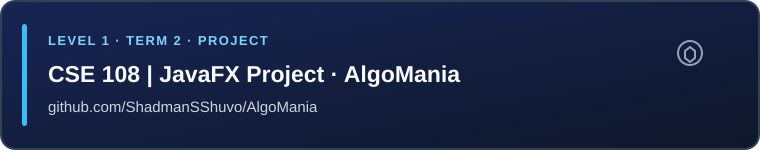](https://github.com/ShadmanSShuvo/AlgoMania)

**Repository:** [ShadmanSShuvo/AlgoMania](https://github.com/ShadmanSShuvo/AlgoMania)

---

<h2 align="center" id="level-2---term-1">Level 2 - Term 1</h2>

### CSE 206 | Digital Logic Design

[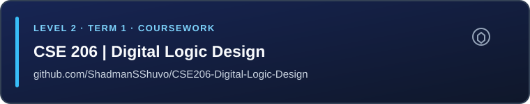](https://github.com/ShadmanSShuvo/CSE206-Digital-Logic-Design)

**Repository:** [ShadmanSShuvo/CSE206-Digital-Logic-Design](https://github.com/ShadmanSShuvo/CSE206-Digital-Logic-Design)

### CSE 208 | Data Structures and Algorithms II

[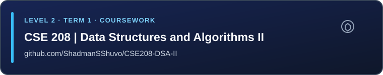](https://github.com/ShadmanSShuvo/CSE208-DSA-II)

**Repository:** [ShadmanSShuvo/CSE208-DSA-II](https://github.com/ShadmanSShuvo/CSE208-DSA-II)

### CSE 216 | Database

[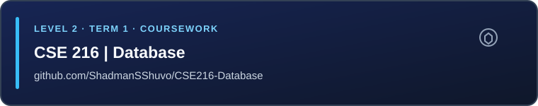](https://github.com/ShadmanSShuvo/CSE216-Database)

**Repository:** [ShadmanSShuvo/CSE216-Database](https://github.com/ShadmanSShuvo/CSE216-Database)

### CSE 216 | Database Project · eduVerse

[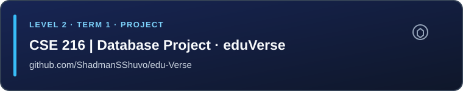](https://github.com/ShadmanSShuvo/edu-Verse)

**Repository:** [ShadmanSShuvo/edu-Verse](https://github.com/ShadmanSShuvo/edu-Verse)

---

<h2 align="center" id="level-2---term-2">Level 2 - Term 2</h2>

### CSE 200 | Technical Writing & Presentation

[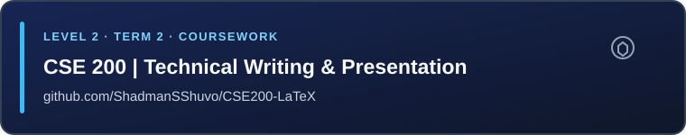](https://github.com/ShadmanSShuvo/CSE200-LaTeX)

**Repository:** [ShadmanSShuvo/CSE200-LaTeX](https://github.com/ShadmanSShuvo/CSE200-LaTeX)

### CSE 210 | Computer Architecture

[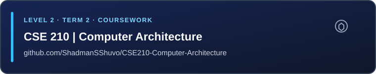](https://github.com/ShadmanSShuvo/CSE210-Computer-Architecture)

**Repository:** [ShadmanSShuvo/CSE210-Computer-Architecture](https://github.com/ShadmanSShuvo/CSE210-Computer-Architecture)

### CSE 214 | Software Engineering

[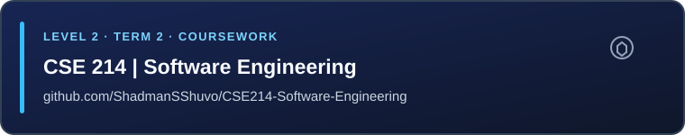](https://github.com/ShadmanSShuvo/CSE214-Software-Engineering)

**Repository:** [ShadmanSShuvo/CSE214-Software-Engineering](https://github.com/ShadmanSShuvo/CSE214-Software-Engineering)

### CSE 220 | Signals & Linear Systems

[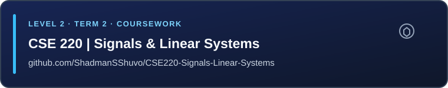](https://github.com/ShadmanSShuvo/CSE220-Signals-Linear-Systems)

**Repository:** [ShadmanSShuvo/CSE220-Signals-Linear-Systems](https://github.com/ShadmanSShuvo/CSE220-Signals-Linear-Systems)

### CSE 220 | Signals Project · QRSense

[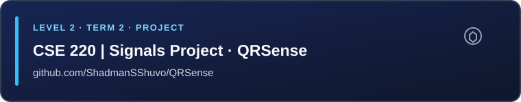](https://github.com/ShadmanSShuvo/QRSense)

**Repository:** [ShadmanSShuvo/QRSense](https://github.com/ShadmanSShuvo/QRSense)

---

<h2 align="center" id="level-3---term-1">Level 3 - Term 1</h2>

*Coming soon.*

---

<h2 align="center" id="level-3---term-2">Level 3 - Term 2</h2>

*Coming soon.*

---

<h2 align="center" id="level-4---term-1">Level 4 - Term 1</h2>

*Coming soon.*

---

<h2 align="center" id="level-4---term-2">Level 4 - Term 2</h2>

*Coming soon.*

---

<i>Maintained by <a href="https://github.com/ShadmanSShuvo">ShadmanSShuvo</a></i>

